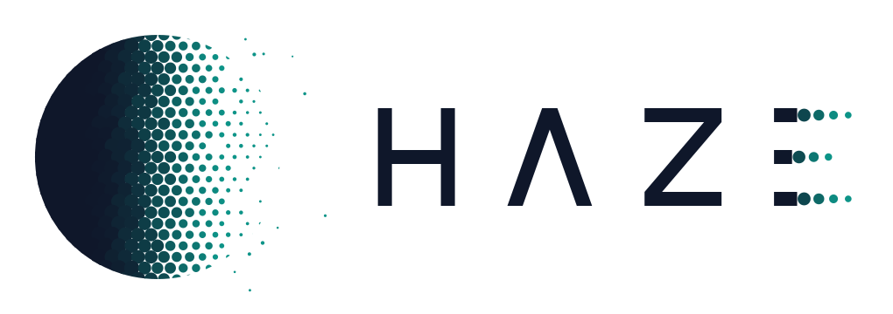

<p align="center">
  <picture>
    <source media="(prefers-color-scheme: dark)" srcset="docs/images/logo-dark.svg">
    
  </picture>
</p>

# Haze: Verifying Software with Uncertain Outcomes

[](LICENSE.md)
[](https://lean-lang.org)

Haze is a small language for checking software that has to cope with things going wrong some
of the time. You write a model of a system, such as a payment client that retries failed
requests, together with the parts you don't control: messages that get lost, services that go
down, rates you only have a rough idea of. Then you state what the system should guarantee,
and Haze checks it.

Because the model includes chance, the answers aren't simply true or false. Haze works out how
likely each outcome is, exactly, with fractions rather than simulation, and when a guarantee
can fail it shows you a run where it does. Some inputs aren't really probabilities. If all you
know is that packet loss is "around 2%, maybe worse", you can write exactly that, and Haze
answers with a range: how strongly what you know guarantees the property, and how strongly it
allows it.

Haze is written in [Lean 4](https://lean-lang.org/) and borrows its design. Your program is
translated into a small core language, and a separate kernel checks every declaration again
before accepting it. What Haze adds is what that kernel keeps track of: besides the type of
each term, it records whether the term depends on chance, on a rough estimate, or on a
computation that might not finish.

## Example

Take the payment client from above. It retries when a request or its reply is lost, and the
server charges the card every time a request reaches it. We want two things: almost every
payment should go through, and no customer should ever be charged twice.

```haze
param loss : Num ~= {0.01: 0.6, 0.02: 1, 0.05: 0.5, 0.1: 0.2}

system Naive {
  var phase : Phase := Sending
  var charges : Num := 0
  ...
}

claim delivered : Naive |= eventually[6] phase == Done with prob >= 0.99
theorem naive_single_charge : Naive |= always[6] charges <= 1
```

Haze accepts the first requirement and rejects the second. The run it reports is the classic
bug: the first request went through, its reply was lost, and the retry charged the card again.

```
payments_retry.hz:92:1: info: claim delivered
  belief ≈0.998319 · plausibility ≈0.99997 — graded
  bound holds: belief ≥ 0.99
payments_retry.hz:97:1: error: theorem naive_single_charge
  belief ≈0.955681 · plausibility ≈0.986011 — graded
  theorem rejected: belief is ≈0.955681, not 1
  counterexample at step 3 (path mass ≈9.801e-5 (=9801/100000000), degree 0):
    parameters: loss = 0.01
    state: phase = Waiting, attempts = 2, charges = 2, acked = false, latency = 1000
```

Giving each payment an idempotency key fixes this, and with that change Haze proves the theorem
for every loss rate in the model. The full model is in
[`examples/payments_retry.hz`](examples/payments_retry.hz).

## Learn Haze

The best place to start is the tutorial,
[`examples/Tutorial/JobWorker.hz`](examples/Tutorial/JobWorker.hz). It models a background
worker that calls a flaky downstream service, and builds the model up step by step, from a
single random value to a full system with theorems, fuzzy parameters and observations. Its
output is in [`JobWorker.expected`](examples/Tutorial/JobWorker.expected), so you can read the
two side by side. Every construct of the language is described in the
[language reference](docs/Language-Reference.md).

After that, the [`examples`](examples) folder has models of common reliability problems:

| Example | What it checks |
|---|---|
| [`payments_retry.hz`](examples/payments_retry.hz) | Retries after a lost reply charge the customer twice, and idempotency keys prevent it. |
| [`quorum_replication.hz`](examples/quorum_replication.hz) | Reads see the latest write when R + W > N, and can be stale when R = 1. |
| [`circuit_breaker.hz`](examples/circuit_breaker.hz) | A circuit breaker's invariants, how fast it trips, and how much load it sheds when the upstream is flaky. |
| [`canary_rollout.hz`](examples/canary_rollout.hz) | Whether a defective build can reach all traffic during a staged rollout. |
| [`incident_triage.hz`](examples/incident_triage.hz) | The likely root cause of an incident, given which alerts fired. |
| [`probability_classics.hz`](examples/probability_classics.hz) | Textbook problems with known answers, such as the birthday problem, gambler's ruin and the boy–girl paradox. |

Haze isn't limited to software. The models in [`examples/Gallery`](examples/Gallery) come from
other fields, and each of their answers has been checked against a closed-form result or an
independent calculation (see [`scripts/verify_gallery.py`](scripts/verify_gallery.py)):

| Example | Field | What it computes |
|---|---|---|
| [`genetics.hz`](examples/Gallery/genetics.hz) | Genetics | How often genetic drift fixes a new allele, Hardy–Weinberg proportions when the allele frequency is only roughly known, and a Mendelian cross. |
| [`epidemic.hz`](examples/Gallery/epidemic.hz) | Epidemiology | How many people in a household catch an infection (the Reed–Frost model), with and without vaccination. |
| [`physics.hz`](examples/Gallery/physics.hz) | Physics | Radioactive decay, diffusion between two chambers, and how often a random walk returns to its start. |
| [`reliability.hz`](examples/Gallery/reliability.hz) | Reliability engineering | A proof that a three-way voter masks any single failure, plus redundant pumps and server availability. |
| [`finance.hz`](examples/Gallery/finance.hz) | Finance | Option prices on a binomial tree, put–call parity, prices when volatility is uncertain, and an insurer's risk of ruin. |
| [`games.hz`](examples/Gallery/games.hz) | Games | The odds in craps (244/495), winning a game of tennis from deuce, and Penney's coin game. |
| [`queueing.hz`](examples/Gallery/queueing.hz) | Networking | How full a network buffer gets and how many packets it drops when the arrival rate is uncertain. |
| [`game_physics.hz`](examples/Gallery/game_physics.hz) | Video games | Objects tunneling through walls, energy drift in physics integrators, and jumps that depend on the frame rate. |

[`examples/Law/sally_clark.hz`](examples/Law/sally_clark.hz) looks at a real court case. In R v
Clark, a mother was convicted of murdering her two sons partly on the strength of a "1 in 73
million" statistic. The model recomputes that figure from the numbers given in court, then
asks the question the jury should have been asked, using the published analysis of the case.

Finally, [`examples/Conformance`](examples/Conformance) shows how to use a Haze model as the
specification of real code. A test runs a Python payment client against every pattern of lost
messages and checks that its outcomes match the model's probabilities exactly.

## Build

You need [elan](https://github.com/leanprover/elan), the Lean toolchain manager. The Lean
version is pinned in [`lean-toolchain`](lean-toolchain), and elan installs it the first time
you build.

```sh
lake build                       # the library, its theorems and the haze command
lake exe haze FILE.hz            # check a model
lake test                        # run the test suite
```

`haze` exits with status 1 if any declaration is rejected, so it can run in CI. Two options are
worth knowing: `--fuel N` limits how deeply function calls can nest before an outcome counts as
unknown (the default is 1000), and `--json` prints the results as JSON for other programs.

## Documentation

- [Language reference](docs/Language-Reference.md)
- [Design and semantics](docs/Design.md), including how Haze relates to Lean
- [Test suite](tests/README.md)
- [Release notes](RELEASES.md)
- [Contributing](CONTRIBUTING.md)

## License

Haze is available under the [PolyForm Noncommercial License 1.0.0](LICENSE.md), which allows
personal, research, educational and other non-commercial use. For commercial use, please get
in touch.

Required Notice: Copyright (c) 2026 Ritabrata Maiti
